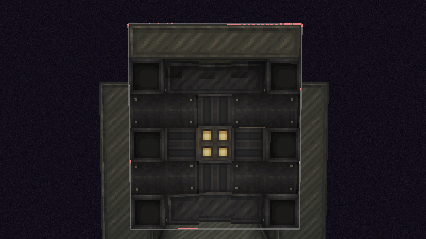
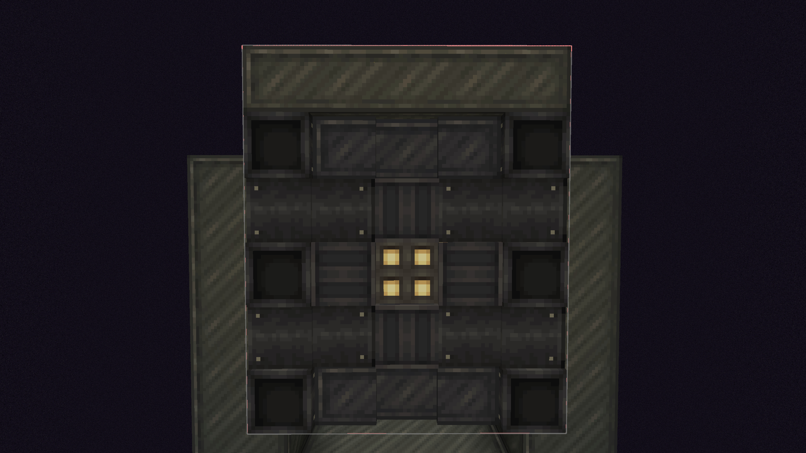

# Copycats Sable Light Fix

Fixes incorrect ambient occlusion (AO) on copycat models rendered inside Sable sub-levels.

**Mod ID:** `copycats_sable_light_fix` | **Version:** 1.0.0 | **Loader:** NeoForge 1.21.1

---

## Description

This mod fixes incorrect ambient occlusion (AO) / smooth lighting on copycat models (from Create, Create: Extra Copycats, and related mods) when they are rendered inside Sable sub-levels.

Without the fix, copycat blocks appear noticeably darker and visually inconsistent with their surroundings inside Sable contraptions. With the fix, lighting matches normal expectations -- no other blocks are affected.

## Before / After

| Before (broken AO) | After (fixed AO) |
|:---|:---|
|  |  |

## How it works

1. **Detection** - When `ModelBlockRenderer.tesselateBlock()` is called, the mod checks whether the rendered `BakedModel` is a copycat model (`instanceof CopycatModel` or by class name `com.fiisadev.extra_copycats.*`).

2. **Interception** - Instead of redirecting `Minecraft.useAmbientOcclusion()` (which gets inlined and is invisible to mixins at runtime), the mod redirects the actual call to `ModelBlockRenderer.tesselateWithAO()` inside `tesselateBlock()`.

3. **Fallback** - If the model is a copycat, the call is redirected to `tesselateWithoutAO()` (flat lighting). Otherwise, the original `tesselateWithAO()` path is preserved.

4. **Safety** - The mod uses `try-catch` + class-name fallback so it does not crash if Extra Copycats is not installed. It only affects copycat models; all other blocks render with normal AO.

## Technical details

| Parameter | Value |
|-----------|-------|
| Minecraft | 1.21.1 |
| Loader | NeoForge 21.1.262+ |
| Mixin | Sponge 0.16.4+mixin.0.8.7 |
| Redirect target | `ModelBlockRenderer.tesselateWithAO(...)` via `@Redirect` |
| Client-only | Yes |

## Dependencies

| Mod | Type |
|-----|------|
| NeoForge | Required |
| Minecraft 1.21.1 | Required |
| Sable 2.0+ | Required |
| Extra Copycats 1.0+ | Required |

## Building from source

```bash
cd copycats_sable_light_fix
export JAVA_HOME="C:\\Program Files\\Eclipse Adoptium\\jdk-21.0.13.9-hotspot"
./gradle-8.8/bin/gradle.bat build -x test
# JAR -> build/libs/copycats_sable_light_fix-1.0.0.jar
```

Place the JAR in your `mods/` folder.

---

Based on Sable upstream issue #1479.
